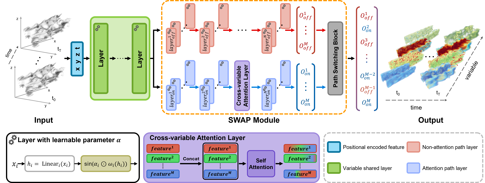
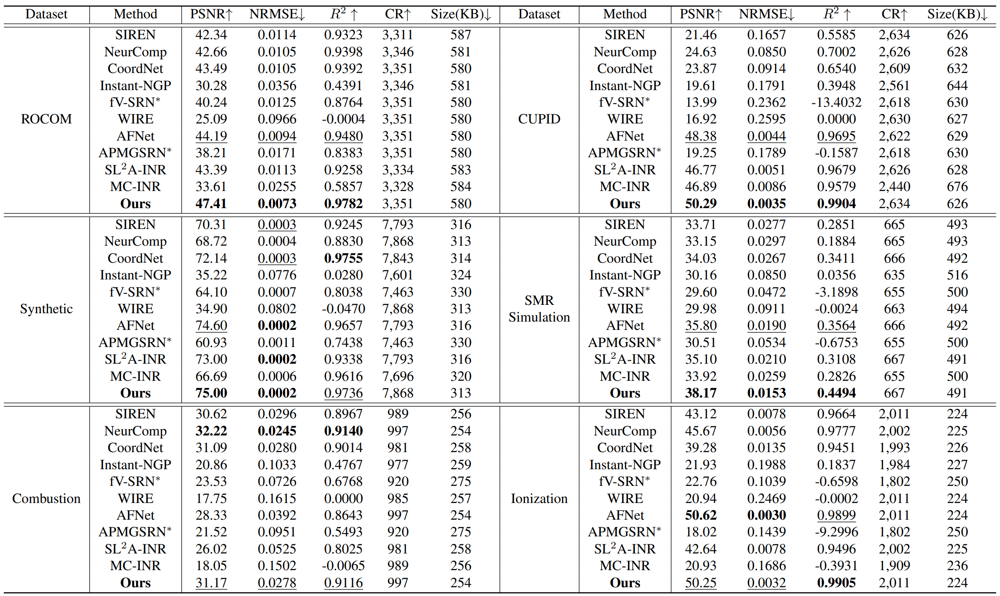

<div align="center">

# SWAP-INR: Implicit Neural Representation with Switchable Attention Paths for Time-varying Multivariate Scientific Data Compression

**Accepted at WACV 2027**  
**Paper:** Coming soon

</div>

## Overview

<p align="center">
  
</p>

**Figure 1. Overview of the proposed SWAP-INR.** Given a spatiotemporal coordinate $(x, y, z, t)$, the network first applies positional encoding. The encoded features are processed by MLP layers shared across variables, equipped with **A²-SIREN**, which employs a learnable parameter $\boldsymbol{\alpha}$ for adaptive frequency modulation (bottom left). The representations are then split into two branches: a non-attention path (red) and an attention path (blue). The attention branch models cross-variable interactions using a cross-variable attention layer (purple). Finally, the **variable-driven path switching** block selects the appropriate representation for each variable to reconstruct high-fidelity multivariate outputs.

## Main Results

<p align="center">
  
</p>

**Table 1. Quantitative comparison of compression results with previous methods at matched CR.** The `*` denotes that the reported performance is averaged across independent time steps. Baselines are stored at 32-bit precision, while **SWAP-INR** uses 16-bit.


## Reproduction with Downsampled Datasets

Due to supplementary-material size limitations, the provided model weights and example datasets for **ROCOM** and **Ionization** use downsampled versions of the original datasets. The original full-resolution datasets used for the paper experiments are substantially larger.

### Dataset Sizes

| Dataset | Original dataset size (paper) | Downsampled dataset size (repository) |
| :-- | --: | --: |
| ROCOM | 1,943,807 KB | 80,995 KB |
| Ionization | 450,469 KB | 11,270 KB |

### Results with Provided Models and Downsampled Data

| Dataset | Evaluation | PSNR ↑ | NRMSE ↓ | $R^2$ ↑ |
| :-- | :-- | --: | --: | --: |
| ROCOM | Paper (original data) | 47.41 | 0.0073 | 0.9782 |
| ROCOM | Repository (downsampled data) | 43.06 | 0.0108 | 0.9421 |
| Ionization | Paper (original data) | 50.25 | 0.0032 | 0.9905 |
| Ionization | Repository (downsampled data) | 53.66 | 0.0021 | 0.9810 |

> **Note:** The supplied checkpoints were obtained using downsampled ROCOM and Ionization data. These results are **not directly comparable** with full-dataset results because the evaluation data differ. All results reported in this reproduction table were obtained using **FP16**.

## Usage

Run the following commands from the `code/` directory:

```bash
cd code/
```

### Training

**ROCOM**

```bash
python train.py --dataset ROCOM_down_down --num_var 8 --Shared_hidden 64 --Branch_hidden 32 --name ROCOM_down_down_test --device cuda
```

**Ionization**

```bash
python train.py --dataset ionization_down_down --num_var 4 --Shared_hidden 64 --Branch_hidden 24 --name ionization_down_down_test --device cuda
```

The `--name` argument is required. Checkpoints and pruned models are saved under:

```text
Exp/<dataset>/<name>/
```

Additional training options:

```bash
python train.py \
  --dataset ROCOM_down_down \
  --name experiment_name \
  --device cuda \
  --batch_size 100000 \
  --base_num_epochs 2000 \
  --on_num_epochs 1000
```

Use `--device cpu` if CUDA is unavailable.

### Inference

Use the **same dataset, experiment name, and model architecture arguments** as in training.

**ROCOM**

```bash
python inference.py --dataset ROCOM_down_down --num_var 8 --Shared_hidden 64 --Branch_hidden 32 --name ROCOM_down_down_test --device cuda
```

FP16 inference:

```bash
python inference.py --dataset ROCOM_down_down --num_var 8 --Shared_hidden 64 --Branch_hidden 32 --name ROCOM_down_down_test --use_half --device cuda
```

**Ionization**

```bash
python inference.py --dataset ionization_down_down --num_var 4 --Shared_hidden 64 --Branch_hidden 24 --name ionization_down_down_test --device cuda
```

FP16 inference:

```bash
python inference.py --dataset ionization_down_down --num_var 4 --Shared_hidden 64 --Branch_hidden 24 --name ionization_down_down_test --use_half --device cuda
```

## Citation

Citation information will be added when the official WACV 2027 paper metadata is available.
